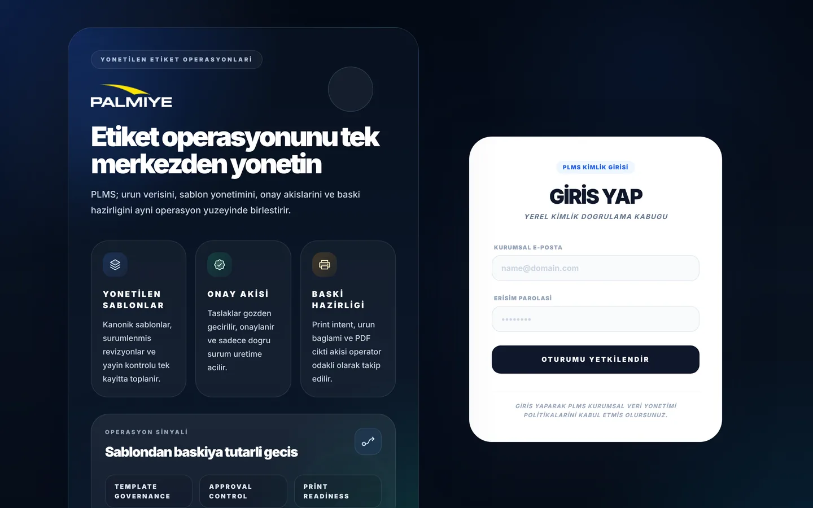
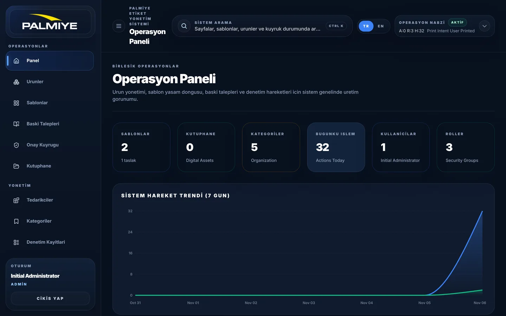
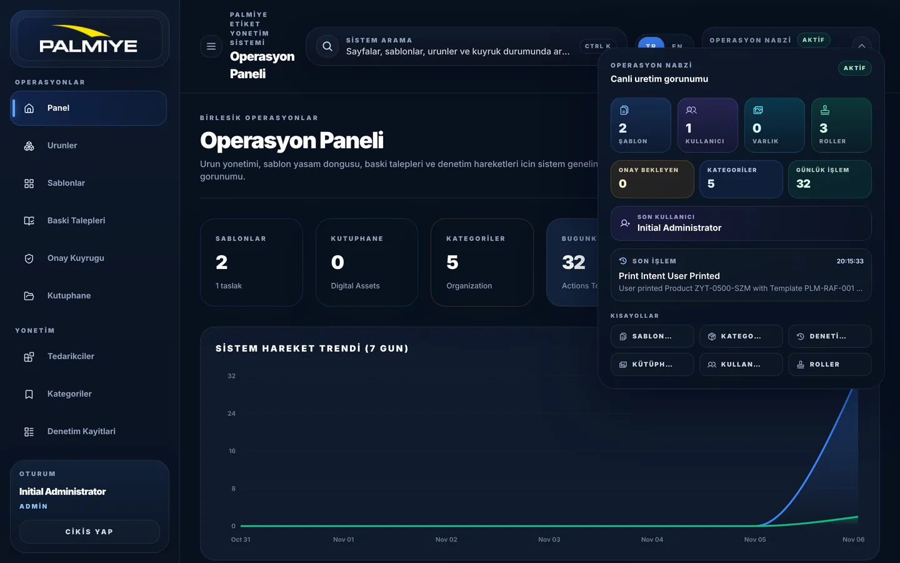
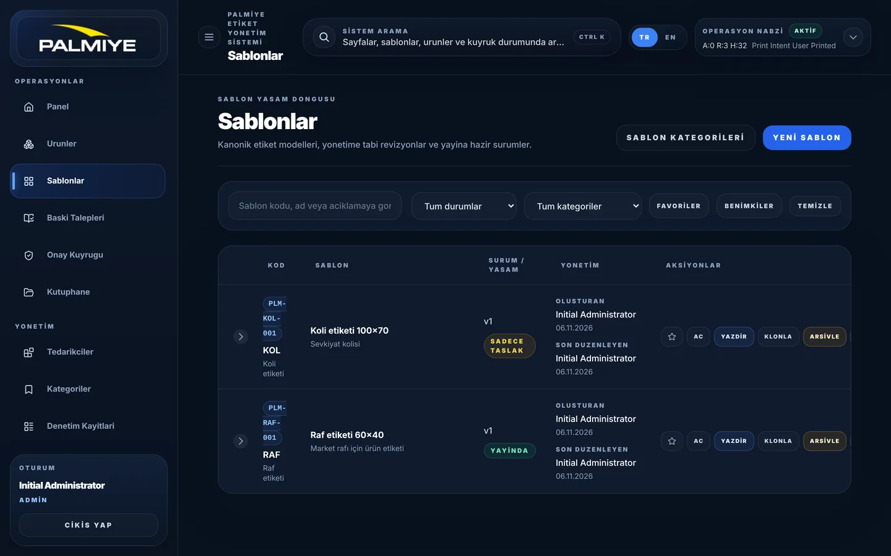
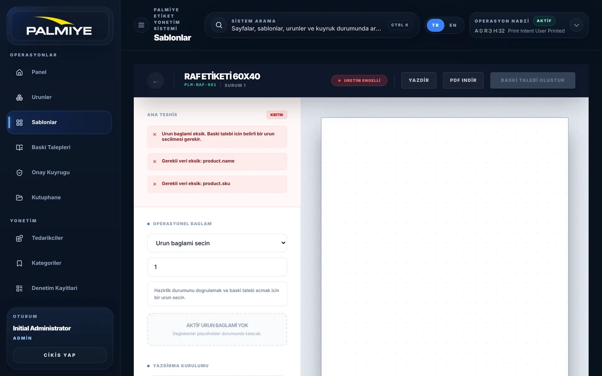
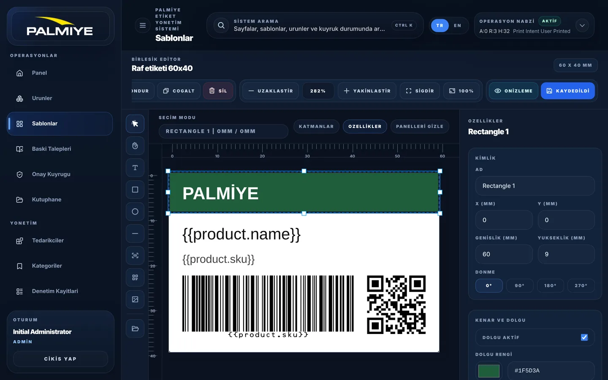
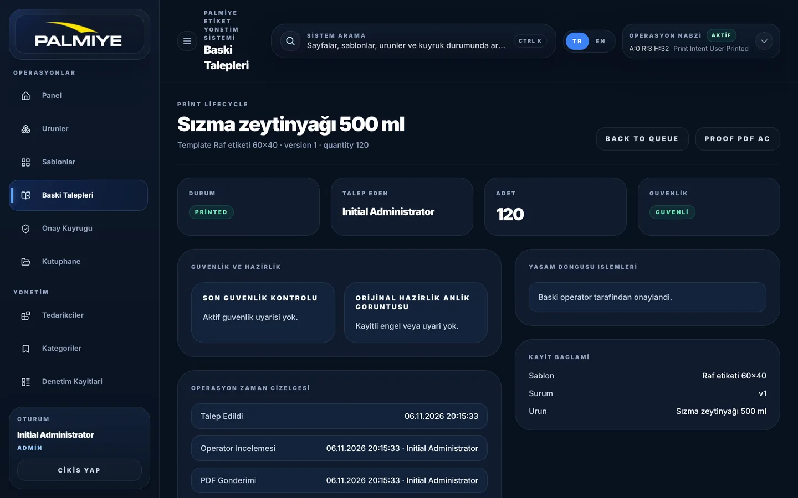

# PLMS: Unslop denetimi, işlev incelemesi ve yol haritası

**Tarih:** 6 Kasım 2026
**Kapsam:** `src/frontend` (57 dosya), `src/backend/Plms.Api`, `docs/`, `.agents/`
**Yöntem:**
- Tasarım: [unslop](https://github.com/heydamir/unslop) skill'inin `signs.md` kontrol listesi ve `tokens.md` değerleri
- Uygulama: yerelde çalıştırıldı (.NET 8 + PostgreSQL 16 + Next.js dev) ve demo verisiyle 20 ekranın görüntüsü alındı
- Kod: kodda doğrulanan hatalar ayrıca işaretlendi
- Rakip analizi: 15+ ürün incelendi
**Durum:** Yalnızca rapor. Bu çalışmada uygulama kodu değiştirilmedi.

> **Diğer PR'lar hakkında:** GitHub'da bu repoda açık ya da kapalı hiç PR yok. Yalnızca `main` dalı var ve son commit `a009e69` (24 Mart 2026). Başka bir araçta yapılıp push edilmemiş işler bu incelemeye girmedi. Varsa push edildikten sonra rapor güncellenebilir.

---

## A. Özet

1. **Yönetişim tarafı iyi durumda, baskı tarafı zayıf.**
   - Hazır olanlar: şablon sürümleme, onay akışı, arşiv/geri yükleme, CSV dry-run içe aktarma ve denetim kaydı.
   - Baskı tarafında her PDF tek etiket basıyor ve adet (quantity) dikkate alınmıyor.
   - Yeniden baskı (reprint) yok, basılan verinin anlık görüntüsü de yok.
   - Talep (print intent) dışından, denetim kaydı bırakmadan da baskı alınabiliyor.
2. **Arayüz baştan sona tek bir AI slop kalıbıyla yazılmış.**
   - Her etiket, buton, rozet ve tablo başlığı `text-[10px] font-black uppercase tracking-[0.22em]`.
   - Uygulamada `font-black` 384, `uppercase` 319, keyfi `tracking-[…]` 305 kez geçiyor.
   - `tabular-nums` hiç kullanılmıyor.
3. **Türkçe karakterler arayüzün neredeyse tamamında yok.**
   - `messages.ts`'te sıfır Türkçe karakter var: "Sablon", "Urun", "Yukleniyor".
   - CSS `uppercase` Türkçe locale'de `i`'yi `İ` yapıyor, ama `ş/ğ/ü` olmadığı için "BİRLESİK", "GİRİS YAP", "CİKİS YAP" gibi karışık yazımlar çıkıyor.
   - Türkçe arayüzde İngilizce metinler de var: "Back to Queue", "Print lifecycle", "PRINTED", "Digital Assets".
4. **Ekranlarda düzen hataları görünüyor:**
   - 1440px'te üst bardaki sistem adı 4 satıra kırılıyor.
   - Şablon listesinde kod hapı 3 satıra bölünüyor ve aksiyon butonları sağdan taşıyor.
   - Editör araç çubuğu kırpılıyor ("NDUR").
5. **Bu inceleme sırasında bulunan önemli hatalar:**
   - Editör, yayınlanmış bir sürümü açınca kendiliğinden taslak oluşturuyor. Dev ortamında bir açılışta iki taslak (v2, v3) oluştu.
   - Kategori veya tedarikçi değişkeni kullanan şablonlarda baskı talebi yanlışlıkla engelleniyor.
   - "Popup engellendi" uyarısı her seferinde yanlış çıkıyor.
   - Bazı opaklık sınıfları hiç CSS üretmiyor.
6. **En büyük iş değeri:** operatör için tek ekranlı bir **Baskı İstasyonu**. Ürünü ara veya barkodu okut, adet gir, önizle, bas, sonucu onayla.
7. **Önerilen tasarım yönü:** açık tema, grafit nötrler, tek vurgu rengi, IBM Plex Sans + Mono. Gerçek ölçekli etiket önizlemesi ekranın "parlak anı" olur.

---

## B. Unslop denetimi

### B.1 Mevcut görsel kimlik

| Konu | Bugün |
|---|---|
| Tema | Yalnızca koyu lacivert (`#08111f`), arka planda mavi ve yeşil radyal parıltılar (`globals.css:23-26`). Login kartı, ürün oluşturma ve şablon önizleme ise beyaz, yani tema içinde tema var. |
| Vurgu renkleri | Kabukta 5 renk: mavi, zümrüt, kehribar, mor, camgöbeği. `blue-*` 261 kez ham olarak kullanılıyor; `--plms-primary/success/danger/warning` token'ları **0 kez** kullanılıyor. |
| Yazı | Inter. Ağırlıkların neredeyse hepsi 900 (`font-black` ×384). Büyük başlıklarda `-0.04em…-0.07em` sıkıştırma, küçük etiketlerde `0.18–0.28em` açma. |
| Köşe | `rounded-2xl` ×159, `3xl` ×36, `full` ×54 ve `rounded-[0.95rem]…[2.75rem]` arasında 12 farklı keyfi değer. |
| Gölge | 34 keyfi `shadow-[…]`, bunların 26'sı farklı değer. Bir ölçek yok. |
| Token | 15 CSS değişkeni tanımlı ama `tailwind.config.ts` → `extend: {}`, yani Tailwind'e bağlı değiller. 678 kez `[color:var(--plms-…)]` biçiminde uzun sınıflarla kullanılıyorlar. |
| İkon | Phosphor, lucide'dan kopyalanmış 11 animasyonlu ikon (`ui/*-icon.tsx`), inline SVG ve Unicode ← ✕ ✓ ! olmak üzere 4 sistem. Boyutlar 12–28px arasında 8 farklı değer. |
| Hareket | Sayfa geçişinde blur (`PageTransition.tsx`), login'de sonsuz float/orbit/pulse, `transition-all` ×21, 29 kopyala-yapıştır `animate-spin`. |
| Sayfa genişliği | 7 farklı değer: `3xl`, `4xl`, `5xl`, `6xl`, `7xl`, `[1600px]`, `[1720px]`. |

### B.2 Sayılarla işaretler

| İşaret (unslop `signs.md`) | Adet |
|---|---|
| `font-black` / `font-bold` | 384 / 68 |
| `uppercase` | 319 |
| Keyfi `tracking-[…]` | 305 |
| `text-[10px]` / `[9px]` / `[11px]` / `[8px]` | 222 / 26 / 21 / 1 |
| `tabular-nums` | **0** |
| Keyfi `[Npx/rem]` değerleri | ~620 |
| `linear/radial-gradient`, `bg-gradient-to` | 19 / 11 / 3 |
| `backdrop-blur` (cam kart) | 12 |
| `transition-all` | 21 |
| `alert()` ile geri bildirim | 12 |
| `messages.ts` dışında inline `locale === "tr"` metin tablosu | 48 kullanım, 34 dosya |
| `messages.ts`'teki Türkçe karakter | **0** |
| Jargon (governance, signal, shell, canonical, posture) | 14 / 15 / 15 / 6 / 4 |
| Emoji, gradient metin, ünlem | 0 (iyi) |

### B.3 Ekran ekran

Her satır şu biçimde: işaret → konum → önerilen düzeltme.

#### Login · `app/auth/login/page.tsx`, `components/auth/LoginShowcasePanel.tsx`

- Arka planda bulanık "blob", yörüngede dönen ve yüzen daireler, ızgara dokusu var (`LoginShowcasePanel.tsx:30-33`). **Kaldır.** Tek düz yüzey yeterli.
- Her biri farklı renkte gradient ikon kutularına sahip üç eş "özellik kartı" var (`:11,16,21,62,71`). **Kaldır** ya da tek satırlık bir açıklamaya indir.
- Başlık `text-5xl font-black tracking-[-0.07em]` (`:53`); harfler birbirine yapışıyor. **400–500 ağırlık**, 0 veya -0.02em tracking kullan.
- `GİRİS YAP`, italik ve büyük harf "YEREL KİMLİK DOGRULAMA KABUGU", "OTURUMU YETKİLENDİR" (`messages.ts:339,701,719`). Yerine "Giriş yap" başlığı ve "Giriş yap" butonu.
- Türkçe arayüzde İngilizce çipler var: "Template Governance / Approval Control / Print Readiness" (`messages.ts:333-335`).
- Kart köşeleri `rounded-[2.75rem]` ve `[2.5rem]`. **16px** yeterli.

#### Kabuk: sidebar ve üst bar · `components/AppShell.tsx`

- Sidebar, logo kutusu, oturum kartı, arama butonu ve dil seçicinin hepsi gradient (`:276,278,327,383,394`). **Düz yüzey ve hairline** kullan.
- Aktif menü öğesinde gradient dolgu, mavi iç halka ve parlayan çubuk var: `shadow-[0_0_12px_rgba(96,165,250,0.6)]` (`:101,109`). Bunun yerine bir yüzey adımı (`#f4f4f5`) ve vurgu renginde 2px sol çizgi.
- Menü satırları yaklaşık 56px yüksek (`:100,110`). Unslop'a göre **32–36px**, satır arası 2–4px olmalı.
- Grup etiketleri, rol ve "CTRL K" 9–10px büyük harf (`:305,330,332,375,389,392`). Sentence case ve 12px kullan; kısayolu küçük bir keycap içinde göster.
- **Hata:** 1440px'te "PALMİYE ETİKET YÖNETİM SİSTEMİ" 4 satıra kırılıyor ve başlık iki satır oluyor (görsel). Sistem adı zaten logoda var; üst bardan kaldır.
- Arama alanının yer tutucu metni çok uzun: "Sayfalar, şablonlar, ürünler ve kuyruk durumunda ar…". Yerine **"Ara"**.
- Düzen sütunlarında `transition-all duration-300` genişlik ve padding'i animasyonla değiştiriyor (`:268-269,276`). Bunu kaldır.
- **Hata (doğrulandı):** `bg-[color:var(--plms-bg)]/88` (`:362`), `bg-slate-950/28` (`:282`) ve `bg-blue-500/8` (`MetricCard.tsx:19-21`) Tailwind 3.4.19'da **hiç CSS üretmiyor**. Derlenen `layout.css`'te bu sınıflar sıfır kez geçiyor; bu yüzden ilgili yüzeylerin arka planı yok.
- `GlobalNavigation.tsx` hiçbir yerde import edilmiyor ve içinde bir "MVP" rozeti duruyor. Ölü kod.

#### Operasyon Nabzı · `components/Operational/OperationalPulse.tsx`

- Üst barda "A:0 R:3 H:32 Print Intent User Printed" yazıyor. Kısaltmalar açıklanmamış, son satır ham bir enum metni (`:88-90`). Yerine "3 onay bekliyor · bugün 32 işlem" gibi bir cümle.
- Yeşil "AKTİF" rozeti hiçbir gerçek durumu yansıtmıyor (`:83,126`). **Kaldır.**
- Dört kutunun dördü de farklı renkte, gradient ve duotone ikonlu (`:133-168,303-306`). Tek nötr ve sayılar `tabular-nums` olmalı.
- **Hata (doğrulandı):** kısayollar kırık. `/admin/categories`, `/admin/audit-logs` ve `/library` var olmayan rotalar (`:248,253,258`); doğruları `/categories`, `/audit-logs` ve `/content-library`.
- Bileşen kendi metin tablosunu taşıyor (`:37-68`); i18n dışında kalıyor.

#### Panel (Dashboard) · `app/page.tsx`

- Altı eş istatistik kartının renkleri primary, success, warning ve neutral arasında anlamsızca dönüyor (`:130-137`). Kartlardaki "Kütüphane 0", "Roller 3" ve "Kullanıcılar 1" operatör için bir şey ifade etmiyor.
- Türkçe arayüzde İngilizce ipuçları var: "Digital Assets", "Organization", "Actions Today", "Security Groups" (`:132-136`).
- "Sistem hareket trendi" grafiği iki renkli ve kalın (`strokeWidth={3}`); 0'dan 32'ye çıkan tek bir eğri gösteriyor, yani bir anlam taşımıyor.
- Panelde **baskı ile ilgili hiçbir metrik yok.**
  - Önerilen metrikler: bugün basılan etiket sayısı, onay bekleyen şablonlar, sonucu girilmemiş baskılar, başarısız baskılar.
  - Önerilen ana grafik: son 14 günün baskı adedi; çizgi grafik, vurgu renginde bugün.
- Mobil (390px): kartlar alt alta tam genişlikte diziliyor, üst bar 4 satır. Yoğunluk azaltılmalı.

#### Şablonlar listesi · `app/templates/page.tsx` (797 satır)

- **Hata (görsel):** kod hapı "PLM-/KOL-/001" 3 satıra kırılıyor; altında kategori kodu ve adı da tekrar ediyor.
- **Hata (görsel):** aksiyon butonları (yıldız, AÇ, YAZDIR, KLONLA, ARŞİVLE, …) sağ kenardan taşıyor ve son buton kırpılıyor. Çözüm: bir birincil aksiyon (Aç), yanında "Yazdır" ve kalanlar `⋯` menüsünde.
- "SADECE TASLAK" rozeti iki satıra kırılıyor ve 6 farklı rozet varyantı inline tanımlı (`:33-43`). Yerine `StatusBadge` ile sakin bir metin ve renkli nokta.
- "Yönetim" sütununda oluşturan ve son düzenleyen bilgisi 4 satır yer kaplıyor. Tek satır yeterli: "Ayşe K. · 06.11.2026".
- Sayfa genişliği `max-w-[1720px]` (`:402`), oysa çoğu sayfa `max-w-7xl` kullanıyor.
- "Kanonik etiket modelleri, yönetime tabi revizyonlar…" gibi jargon kullanılıyor. Yerine "Etiket şablonları ve sürümleri".

#### Şablon detay ve önizleme · `app/templates/[id]/page.tsx`, `app/templates/[id]/preview/page.tsx`

- Önizleme sayfası koyu uygulamanın içinde açık tema kullanıyor ve kabuğun içinde ikinci bir `h-screen` sayfa açıyor (`preview/page.tsx:466`).
- Ürün seçilmeden sayfa kırmızı "ÜRETİM ENGELLİ" ve "KRİTİK" gösteriyor. Ürün seçilmemiş olması normal bir başlangıç durumu, alarm durumu değil. Aynı anda PDF alanı **boş beyaz** kalıyor. Öneri: önce örnek veriyle bir önizleme göster, ürün seçimini en üste koy.
- Kod yorumlarında "Master Diagnostic", "Enterprise Header", "Industrial Sidebar" geçiyor; arayüzde "CRITICAL / CAUTION / VERIFIED" büyük harfle yazılmış (`:89-92,163-166`).
- Dekoratif italik "DATA" filigranı, "SKU_REF:" etiketi, `text-[8px]` ve Unicode ← ✕ ! ikonları var (`:474,549,561,624,628,694`).
- Detay sayfasında 27 `font-black` ve 6'dan fazla `rounded-[2rem]` panel var. Her aksiyonun rengi farklı: kehribar, kırmızı, zümrüt (`[id]/page.tsx:48-54`).

#### Editör · `components/Editor/*`

- Editör, uygulama kabuğunun (sidebar ve üst bar) içinde açılıyor; tuvalden yaklaşık 400px genişlik kayboluyor. Editör tam ekran açılmalı, sidebar daraltılmış olarak.
- **Hata (görsel):** araç çubuğu soldan kırpılıyor ("NDUR" = Döndür). Butonlar yazılı ve büyük harf: "UZAKLAŞTIR", "YAKINLAŞTIR", "SIĞDIR". Yerine ikon, tooltip ve keycap ile kısayol.
- Tuvalde `{{product.name}}` ve `{{product.sku}}` olduğu gibi görünüyor; barkod bile `{{product.sku}}` metnini kodluyor. Örnek ürün verisiyle önizleme gerekli.
- Arka planlar ham hex: `bg-[#08111f]`, `#0b1220` (`EditorShell.tsx:256,284`, `EditorTopBar.tsx:157,199,218`).
- Önizleme butonu camgöbeği, onay butonu yeşil, yani kabuktan farklı iki vurgu rengi daha var (`EditorTopBar.tsx:174,236,274`).
- Inspector'daki tüm alan etiketleri 10px büyük harf: "X (MM)", "GENİSLİK (MM)" (`EditorInspector.tsx:279-380`). "mm" birimi değerin yanında mono yazılmalı.
- `LegacyEditorWorkspace.tsx`, `Canvas.tsx` ve `BarcodeRenderer.tsx` yalnızca `NEXT_PUBLIC_EDITOR_ENGINE=legacy` olduğunda çalışıyor, yani pratikte ölü kod.

#### Ürünler, içe aktarma, baskı talepleri, onaylar, yönetim

- **Baskı talebi detayı:**
  - Türkçe arayüzde İngilizce metinler: "PRINT LIFECYCLE", "BACK TO QUEUE", "PROOF PDF AC", "PRINTED", "Template … version 1 · quantity 120" (`print-intents/[id]/page.tsx:151`).
  - "Baskı niyeti" ile "Baskı talepleri" ifadeleri karışık kullanılıyor.
  - 17 `font-black` ve 14 `uppercase` ile en yoğun dosya bu.
- **Baskı talepleri listesi:** dört kart üç sütunlu ızgaraya yerleştirilmiş, bu yüzden dördüncü kart tek başına alt satıra düşüyor (`print-intents/page.tsx:61-85`).
- **Yeni baskı talebi:** tüm ürünler düz bir `<select>` içinde listeleniyor; yüzlerce üründe kullanılamaz hale gelir.
- **Ürün oluşturma:** koyu uygulamanın içinde beyaz bir form (`products/new/page.tsx:122-134`), yer tutucular İngilizce.
- **İçe aktarma:** ikon yerine dev "CSV" harfleri (`products/import/page.tsx:119`); sonuç `alert()` ile bildiriliyor.
- **Kullanıcılar:** tablo yerine üst üste `rounded-[2rem]` kartlar (`admin/users/page.tsx:232`). Detay sayfasında İngilizce "Administration", "Temporary password".
- **Onaylar:** her öğe büyük gölgeli bir `rounded-3xl` kart. Onay detay sayfası başka bir sayfaya link vermekten öteye geçmiyor, yani fazladan bir tık.
- **Ortak `ui/*` bileşenleri:**
  - `PageHeader` her sayfada 0.28em aralıklı bir eyebrow ve `text-4xl font-black` başlık basıyor.
  - `EmptyState` aynı şeyi iki kez söylüyor ("Kayıt yok" eyebrow'unun altında başlık).
  - `DataTable`'da `shadow-[0_20px_70px…]` ve 10px büyük harf başlıklar var.
  - Bu üç bileşen slop'u tüm ekranlara yayıyor; **düzeltme buradan başlamalı.**

Diğer görseller: [şablon detay](screens/05-template-detail.webp), [ürünler](screens/08-products.webp), [ürün detay](screens/09-product-detail.webp), [içe aktarma](screens/10-product-import.webp), [baskı talepleri](screens/11-print-intents.webp), [yeni talep](screens/13-print-intent-new.webp), [onaylar](screens/14-approvals.webp), [kullanıcılar](screens/15-users.webp), [roller](screens/16-roles.webp), [denetim](screens/17-audit-logs.webp), [kütüphane](screens/18-content-library.webp), [arama](screens/19-search-palette.webp), [mobil panel](screens/20-dashboard-mobile.webp).

### B.4 En kötü 15 dosya

1. `components/auth/LoginShowcasePanel.tsx`: blob, orbit, float, cam kart, gradient kutular.
2. `components/AppShell.tsx`: 5 gradient, parlayan menü, 3 ikon seti, CSS üretmeyen sınıflar, 4 satıra kırılan başlık.
3. `components/Operational/OperationalPulse.tsx`: 4 renkli kutular, sahte "Aktif" rozeti, kırık linkler.
4. `app/templates/[id]/preview/page.tsx`: tema içinde tema, 41 adet 9–11px metin, filigran, alarmla açılan sayfa.
5. `app/globals.css`: radyal parıltılar, büyük harf ve 900 ağırlıklı buton sınıfları, sonsuz animasyonlar.
6. `app/auth/login/page.tsx`: gradient katmanları, italik büyük harf metinler.
7. `components/PageTransition.tsx`: blur geçişi; `filter` ve `will-change` yüzünden `fixed` overlay'ler bozuluyor.
8. `app/page.tsx`: 6 eş kart, İngilizce ipuçları, baskı metriği yok.
9. `lib/i18n/messages.ts`: Türkçe karakter yok, Türkçe arayüzde İngilizce, jargon.
10. `app/print-intents/[id]/page.tsx`: en yoğun büyük harf ve 900 ağırlık, İngilizce metinler.
11. `app/templates/[id]/page.tsx`: renk kodlu butonlar, `rounded-[2rem]` paneller.
12. `components/ui/{StatusBadge,PageHeader,MetricCard}.tsx`: slop'u her ekrana taşıyan ortak bileşenler.
13. `app/templates/page.tsx`: taşan aksiyonlar, kırılan kod hapı, 1720px genişlik.
14. `components/Editor/EditorTopBar.tsx`, `EditorShell.tsx`: kırpılan araç çubuğu, ham hex, iki ek vurgu rengi.
15. `app/products/new/page.tsx`, `app/admin/users/[id]/page.tsx`: tema dışı form, İngilizce metinler.

### B.5 Önerilen yön (unslop adım 4: uygulamadan önce onayınız gerekli)

| Satır | Öneri |
|---|---|
| **Ürün** | Palmiye'nin ürün etiketlerini tasarlayan, onaylatan ve Epson ColorWorks'te basan iç sistem; operatör, tasarımcı ve yöneticiler için. |
| **Karakter** | Kesin, sakin, atölyeye yakın. |
| **Dünya** | Beyaz liner üzerinde etiket rulosu, kesim çizgisi, CMYK mürekkep, baskı provası. |
| **Anlar** | (1) Ürün verisiyle render edilmiş, gerçek ölçekli etiket önizlemesi; liner üzerinde ve kesim kenarıyla, ekranın tek "parlak" öğesi. (2) Panelde son 14 günün baskı grafiği, vurgu renginde "bugün". |
| **İmza** | Etiket önizlemelerinin köşelerinde ince kesim/registration işaretleri ve mm ölçü etiketleri. Yalnızca etiket görünen yerlerde kullanılır. |

**Token önerisi** (unslop `tokens.md` açık graphite rampa):

| Rol | Değer |
|---|---|
| Sayfa / kart / yükseltilmiş | `#fafafa` / `#ffffff` / `#f4f4f5` |
| Hairline | birincil metnin %8'i |
| Metin: birincil / ikincil / soluk | `#171717` / `#525252` / `#737373` |
| Vurgu | Koyu "process cyan" (örn. `#0e7490`, beyaz metinle ≥4.5:1). Palmiye'nin kurumsal bir rengi varsa o kullanılır. |
| Anlamsal | Olumlu `#16a34a`, olumsuz `#dc2626`, uyarı kehribar; yalnızca durum noktalarında |
| Yazı | IBM Plex Sans (arayüz) + IBM Plex Mono (SKU, mm, sayılar, kodlar); ikisinde de tam Türkçe glif var |
| Ölçek | 12 / 13 / 14 / 16 / 20 / 28; ağırlıklar 400 / 500, en fazla 600 |
| Köşe | 6 (etiket, keycap) / 8 (input, buton) / 12 (kart) / 16 (panel) |
| Gölge | `0 1px 2px rgba(0,0,0,.05)`, açılır öğelerde `0 8px 24px rgba(0,0,0,.06)` |
| Hareket | Tek eğri `cubic-bezier(0.22,1,0.36,1)`; 150ms hover, 200ms menü; sayfa geçişi yok veya yalnızca 6px fade-rise |
| Düzen | Sidebar 248px, menü satırları 36px, üst bar 56px, içerik en fazla 1440px, sayfa kenarı 24–32px |
| İkon | Yalnızca Phosphor `regular`, 16/18px, metin rengiyle |

### B.6 Dokuz geçişlik uygulama sırası

1. **Boşluk:** 4px ızgara, keyfi `[Npx]` değerleri temizlenir, menü satırları 36px, kart padding'i 20–24.
2. **Renk:**
   - Token'lar `tailwind.config.ts` içinde `colors.surface/ink/line/accent` olarak tanımlanır.
   - `globals.css` açık rampaya geçer; radyal parıltılar ve gradient'ler kalkar.
3. **İkon:** tek Phosphor seti; `ui/*-icon.tsx` animasyonlu ikonlar ve Unicode glifler kaldırılır.
4. **Metin:**
   - `messages.ts` doğru Türkçe karakterlerle yeniden yazılır.
   - 34 dosyadaki inline metinler `t()`'ye taşınır.
   - Jargon temizlenir.
   - `alert()` yerine toast kullanılır.
5. **Yazı:** IBM Plex; `font-black` ve `uppercase` + `tracking` kaldırılır, sentence case kullanılır, sayılarda `tabular-nums`.
6. **Düzen:**
   - Tek sayfa genişliği.
   - Editör tam ekran açılır.
   - Liste aksiyonları "birincil + ⋯ menüsü" düzenine geçer.
   - Kartlarla dolu panel yerine "3–4 kompakt sayı + bir ana grafik + bir liste" düzeni.
7. **Detay:**
   - Köşe yarıçapları iç içe uyumlu olur.
   - `StatusBadge` sakin metin ve renkli nokta haline gelir.
   - Kısayollar keycap içinde gösterilir.
   - Odak halkası eklenir.
8. **Görsel:** dekorasyon kaldırılır; parlak an, ölçekli etiket önizlemesi ve imza olan kesim işaretleri olur.
9. **Hareket:**
   - `PageTransition` blur'u kaldırılır.
   - Sonsuz animasyonlar kaldırılır.
   - `transition-all` yerine `transition-colors`.
   - 29 kopya spinner yerine tek `Spinner` bileşeni.

Önce ortak bileşenler düzeltilir: `globals.css`, `tailwind.config.ts`, `layout.tsx`, `ui/*` ve `AppShell`. Ardından ekran sırası şöyle: Login → Panel → Şablonlar → Önizleme → Editör → Baskı → kalanlar. Her ekran için `/unslop` çalıştırılır ve önce/sonra görüntüsü alınır.

---

## C. İşlev incelemesi

### C.1 Amaçlanan ürün ile bugünkü durum

| Alan | Doküman (`agent.md`, `PLMS_*v3_2.md`, `docs/architecture`) | Bugün |
|---|---|---|
| Kimlik doğrulama | Entra ID SSO | Yerel ASP.NET Identity + simetrik JWT (`Program.cs:70`). Seed şifresi `Admin123!` (`Program.cs:17`). |
| API erişimi | Proxy yok | Next.js proxy var (`app/api/plms/[...path]/route.ts`) |
| Denetim kaydı | Interceptor + correlation-id | Her controller'da elle yazılıyor; frontend'in gönderdiği `x-correlation-id` yok sayılıyor |
| Baskı işi | `print_jobs` + `print_job_items` + `label_instances` + `reprint_requests` | Yalnızca `PrintIntent` (bir ürün, bir sürüm, bir adet sayısı) |
| Baskı kalitesi | Vektör barkod, font beyaz listesi, sürücü preset'i, test etiketi sihirbazı | Hiçbiri yok |
| Test | Testcontainers ile gerçek Postgres | Yalnızca EF InMemory; test projesi `net10.0`, API `net8.0` |

### C.2 Doğrulanmış hatalar

| # | Hata | Kanıt | Etki |
|---|---|---|---|
| 1 | **Editör sürüm açınca kendiliğinden taslak oluşturuyor** ve yarış durumunda çift taslak açılıyor | `templates/[id]/edit/page.tsx:66-107` → `lib/template-versioning.ts:79` sayfa yüklenirken `POST /revisions` yapıyor. `cancelled` bayrağı isteği iptal etmiyor. Yerelde tek bir açılışta v2 ve v3 bir saniye arayla oluştu (dev'de StrictMode). Backend "tek açık taslak" kuralı uygulamıyor. | Sadece bakmak için açmak bile taslak yaratıyor; sürüm listesi kirleniyor |
| 2 | Kategori/tedarikçi değişkeni kullanan şablonlarda **baskı talebi yanlışlıkla engelleniyor** | `PrintIntentsController.cs:70` `FindAsync` kullanıyor, `Include(Category/Vendor)` yok. `VariableResolutionService` boş değer döndürüyor, `PreviewReadinessService:49-51` bunu "Missing" sayıp hata veriyor. | Önizleme "hazır" derken talep "engelli" çıkıyor |
| 3 | Ürün silme kontrolü PostgreSQL'de çalışmaz | `ProductsController.cs:246` EF sorgusunun içinde `PrintIntentStatuses.IsOpen(...)` metodunu çağırıyor; Npgsql bunu SQL'e çeviremez. InMemory test sağlayıcısı hatayı gizliyor. | Silme isteği 500 hatası verir |
| 4 | **Ürün silinince baskı geçmişi de siliniyor** | `FK_PrintIntents_Products_ProductId` → `ReferentialAction.Cascade` (`InitialWithIdentity` migration) | Denetim zinciri kırılıyor |
| 5 | Kütüphaneden görsel silinince yayınlanmış etiketler bozuluyor | Varlıklar soft-delete ediliyor, render ise `IsActive` filtreliyor (`LabelRenderService.cs:251`) | Yayınlanmış etikette görselin yerine "IMAGE" yer tutucusu çıkıyor |
| 6 | **"Popup engellendi" uyarısı her seferinde yanlış çıkıyor** | `lib/pdf-print.ts:15` `window.open(url,"_blank","noopener,noreferrer")` kullanıyor; HTML spesifikasyonuna göre bu durumda dönüş değeri `null`. Unit test opener'ı mock'ladığı için hatayı yakalamıyor. | Operatör PDF açılmadı sanıyor |
| 7 | CODE_39 sessizce CODE_128 olarak basılıyor | Editör `CODE_39` sunuyor (`EditorInspector.tsx:12`), render bilinmeyen türü CODE_128'e düşürüyor (`LabelRenderService.cs:374-376`) | Yanlış barkod basılıyor |
| 8 | Barkod ve QR yaklaşık 96 DPI raster | `WidthMm * 3.78f` px (`LabelRenderService.cs:190-191`) | 600 DPI Epson çıktısında okuma riski |
| 9 | Adet PDF'e yansımıyor | `LabelRenderService` ve `DispatchPdf` içinde `Quantity` hiç kullanılmıyor | Operatör adedi işletim sisteminin yazdırma penceresine elle girmek zorunda |
| 10 | Yetki politikası kaba | `RequireOperator` 16 izinden **herhangi birini** yeterli sayıyor (`Program.cs:103-119`): `vendors.manage` iznine sahip biri baskı onaylayabilir. `*.view` izinleri uygulanmıyor. Yazar kendi sürümünü onaylayabiliyor. | Rol matrisi büyük ölçüde görsel |
| 11 | Talep ve denetim olmadan baskı alınabiliyor | `GET …/versions/{id}/preview` yalnızca `RequireViewer` istiyor (`TemplatesController.cs:1037-1038`) ve Draft'ı da render ediyor. Şablon listesindeki "Yazdır" butonu bu yolu kullanıyor. | Denetim dışı ve onaysız etiket basılabilir |
| 12 | Tailwind opaklık sınıfları CSS üretmiyor | `/88`, `/28`, `/8` derlenen `layout.css`'te sıfır kez geçiyor | Kabuk yüzeylerinin arka planı yok |
| 13 | Operasyon Nabzı'ndaki linkler kırık | B.3'te ayrıntılı | Kısayollar 404 veriyor |

Kodu okuyarak bulunan ama çalıştırarak denenmeyen "olası" sorunlar:
- Kutuya sığmayan metin QuestPDF'te layout hatasına yol açabilir; metin kaydırma veya küçültme kontrolü yok.
- Backend Docker imajında Arial, Verdana ve Times fontları kurulu değil, bu yüzden PDF ile editör arasında fark ve Türkçe glif riski var.
- `GET /api/Templates` her sürümün tam `LayoutJson`'unu döndürüyor; şablon sayısı arttıkça yavaşlar.

### C.3 Kullanıcıya göre kullanılabilirlik eksikleri

**Baskı operatörü**
- Bir baskı için 6–7 adım gerekiyor: yeni talep → 4 ayrı seçim → oluştur → devret → PDF gönder → işletim sisteminde yazdır → sonucu gir.
- Ürün seçimi düz bir `<select>`; arama ve barkod okutma yok.
- Bir ürün sayfasından "bu ürünü bas" ile başlanamıyor; birden çok ürün tek seferde basılamıyor.
- Sonuç girişi zorunlu bir modal değil, başarısızlık kategorisi yok. `SentToClient` durumunda kalan talepleri listeleyen bir yer yok.
- Yeniden baskı yok.

**Etiket tasarımcısı**
- Örnek veriyle önizleme yok.
- Çoklu seçim, hizalama/dağıtma ve kopyala/yapıştır yok.
- Gruplar yalnızca katman panelinde bir etiket; öğeler birlikte hareket etmiyor.
- Kaydedilmemiş değişiklik uyarısı yok (`beforeunload` hiç kullanılmıyor).
- Metni kutuya sığdırma veya kaydırma, koşullu görünürlük, tarih hesabı ve seri numarası yok.
- Yalnızca 4 değişken var: `sku`, `name`, `category`, `vendor`.
- Sürüm karşılaştırması yalnızca metin üzerinden ve sürümler URL parametresiyle seçiliyor.

**Yönetici / IT**
- Ürün düzenleme ve silme arayüzü yok (API var).
- Ürün, şablon ve talep listelerinde sayfalama yok.
- İçe aktarma yalnızca CSV; şablon dosyası indirilemiyor, XLSX desteklenmiyor.
- Yetkisiz sayfada boş ekran çıkıyor (`RoleGuard`).
- Denetim kaydı dışa aktarılamıyor.

### C.4 Hijyen

- **Ölü kod:** `GlobalNavigation.tsx`, legacy editör üçlüsü, `TestAuthController`.
- **Repoya commit edilmiş log dosyaları:** `backend_log*.txt`, `build_error.txt`, `test_build_error*.txt`, `test_results.txt`, `test_error_refinement.txt`. Hepsi eski Windows çalıştırmalarına ait. `.gitignore`'da oldukları halde repoda duruyorlar.
- **Çok büyük dosyalar:** `TemplatesController.cs` (1540 satır), `templates/page.tsx` (797), `preview/page.tsx` (788), `EditorCanvasStage.tsx` (610).
- **Tekrarlanan mantık:** değişken çözümleme iki yerde (`VariableResolutionService`, `PreviewReadinessService.ResolveValueForDetail`).
- **Sabit kodlanmış değerler:** yedek LAN IP'si `http://192.168.0.99:8080` (`api-base-url.ts`, proxy route).
- **Testler:** CI yok, E2E testi yok.

---

## D. Rakip analizi

### D.1 İncelenen ürünler

| Ürün | Konum | Bize uyan özellikler |
|---|---|---|
| **Loftware Cloud / NiceLabel** | Kurumsal SaaS lideri | Control Center'da sürüm ve onay akışı. **Görsel sürüm farkı:** iki revizyon üst üste, farklar magenta. **Web Printing / Print Form:** operatör yalnızca onaylı etiketi basar. Değişken bazında soru, zorunlu alan ve soru sırası. Fonksiyonlar: Date Offset, Concatenate, GS1-128, check digit. Gıda için EU 1169/2011 alerjen kalınlaştırma. |
| **BarTender** (Librarian, Print Station/Portal) | Yaygın masaüstü ve kurumsal ürün | Ada göre arama ile operatör başlatıcısı. **Barkod okutup bas** ve "otomatik tekrar bas". "Print When" ile koşullu nesne ve katmanlar. GS1 AI sihirbazı. Basılan barkodu doğrulayan verifier entegrasyonu. Reprint konsolu. |
| **TEKLYNX** (CODESOFT, LABEL ARCHIVE, CENTRAL CFR) | **Epson ColorWorks'ün resmi yazılım ortağı** (CMYK/RGB renk eşleme) | Formüller, sayaçlar, tarih ofseti. Baskı anında giriş maskesi ve seçim listesi. LABEL ARCHIVE: onay/ret, e-posta bildirimi, onaylıyı kilitleme, **tek tıkla reprint**, şablon talep portalı, metadata filtreleri. CENTRAL CFR: 21 CFR Part 11 e-imza. |
| **Markem-Imaje CoLOS** | Paketleme hattı kodlama ve etiketleme | Siteler arası merkezi tasarım ve onay, ERP/MES beslemesi, GS1 Digital Link. |
| **Esko WebCenter** | Ambalaj ve artwork onayı | Sıralı onay aşamaları (önce regülasyon, sonra pazarlama). Kesim çizgisi ölçümü. GlobalVision ile otomatik metin ve barkod denetimi. |
| **Kallik Veraciti** | İlaç ve tıbbi cihaz etiketi | Onaylı ifade (phrase) kütüphanesi, kural motoru, çok dilli otomatik çıktı, mobil onay. |
| **Epson ekosistemi** | BarTender UltraLite (bazı ColorWorks modelleriyle gelir) | Metni sığdırma, koşullu baskı, seri numarası. Renk doğruluğu sürücü medya ayarı ve ICC/spot renge bağlı, PLMS'in yönetmesi gereken alan da bu. |
| **Avery, Canva** | Web tabanlı tasarım | Tablodan mail-merge. Marka kiti (logo, renk, font rolleri). Ana şablonda kilitli öğeler. Taşma payı (bleed) ve CMYK PDF. |
| **Brady Workstation** | Endüstriyel etiket | Kilitli öğeli şablonlar, GHS/CLP kimyasal etiket uygulamaları, otomatik kaydetme, dokunmatik kullanım. |
| **Label LIVE, Labeljoy, gLabels, LabelZoom, Labelary** | Hafif ve açık kaynak araçlar | Tablonun her satırı bir etiket, **adet sütunu**, tarih hesabı, otomatik seri, baskı log dosyası; XML stok tanımları; REST ile render. |

### D.2 Özellik kataloğu (PLMS'e göre öncelik)

Rakip kısaltmaları: **LW** Loftware/NiceLabel, **BT** BarTender, **TK** TEKLYNX, **MI** Markem-Imaje CoLOS, **ES** Esko, **KA** Kallik, **BR** Brady, **LL** Label LIVE, **LJ** Labeljoy, **ZD** ZebraDesigner, **AV** Avery, **CA** Canva, **GL** gLabels.

**Tasarım ve editör**

| Özellik | Açıklama | Kimde var | Öncelik |
|---|---|---|---|
| Örnek veriyle canlı önizleme | Tuvalde `{{…}}` yerine seçili ürünün değeri görünür | LW, BT, LL | **Yüksek** |
| Koşullu görünürlük | Kurala göre öğe veya katman gizlenir | BT, LW | Yüksek |
| Formül / birleştirme | `{marka} - {ad}`, alt metin, büyük harf, dolgu | LW, TK, ZD | Yüksek |
| Tarih hesabı | "SKT = baskı tarihi + N gün", GS1 için `yyMMdd` formatı | LW, TK, LL | Yüksek |
| Metni sığdır / kaydır | Font kutuya göre küçülür, taşma uyarısı verilir | BT, LW | Yüksek |
| GS1 oluşturucu + check digit | AI (01, 10, 17, 21) doğrulama, EAN/GTIN kontrol hanesi | BT, LW, TK | Yüksek |
| Taşma payı, güvenli alan, kesim çizgisi | Bindirme ve "güvenli alan dışında" uyarısı | CA, ES | Yüksek |
| Etiket stok (media) kütüphanesi | Boyut, şekil, köşe, boşluk; şablona bağlı | GL, AV | Yüksek |
| Seri numarası / sayaç | İş bazında veya global, adım ve dolgu ayarlı | TK, BT, LL, LJ | Orta |
| Ana şablon / kilitli bölge | Alt şablonlar yalnızca slotları değiştirir | CA, BR | Orta |
| Onaylı metin parçaları | Paylaşılan ifade ve bileşen kütüphanesi | KA, LW | Orta |
| Çok dilli alan | Dil, baskı anında seçilir | LW, KA | Orta |
| Spot renk / marka paleti | Adlandırılmış renkler, CMYK eşlemesi | TK, CA | Orta |
| Çoklu seçim, hizalama, kopyala/yapıştır | Temel editör verimliliği | Hepsi | **Yüksek** |
| Otomatik kaydetme | Tasarım kaybını önler | BR | Yüksek |

**Veri**

| Özellik | Açıklama | Kimde var | Öncelik |
|---|---|---|---|
| Ürün özellikleri | GTIN/EAN, lot, SKT, ağırlık, menşe, içerik ve özel alanlar | Hepsi | **Yüksek** |
| XLSX + kolon eşleme + adet sütunu | Satır başına etiket; CSV şablonu indirilebilir | LL, AV, LJ | Yüksek |
| Doğrulama kuralları | Zorunlu alan, maske, min/max, regex, seçim listesi | TK, LW, BT | Yüksek |
| REST baskı API'si | ERP baskıyı "şablon + ürün + adet" ile ister | LW, BT, TK | Orta |
| ERP ürün senkronu | SAP vb. sistemlerden ürün ana verisi | LW, TK, MI | Orta |

**Baskı**

| Özellik | Açıklama | Kimde var | Öncelik |
|---|---|---|---|
| **Operatör baskı istasyonu** | Yalnızca onaylı şablonlar; ara veya okut, form, adet, bas | LW, BT, TK | **Yüksek** |
| Baskı anı formu | Lot, tarih, ağırlık sırayla sorulur; zorunlu alan bayrağı | LW, BT, TK | Yüksek |
| Toplu iş | Çok ürün, her birine adet, tek PDF | LL, BT, BR | Yüksek |
| Gerekçeli reprint | Aynı veriyle birebir tekrar; gerekçe zorunlu, orijinale bağlı | TK, BT | Yüksek |
| Gerçek ölçekli önizleme | PDF render edilip yakınlaştırılabilir | LW | Yüksek |
| Yazıcı/medya profili | Mat/parlak medya, ofset, test etiketi | Epson, LW | Orta |
| Büyük işlerde amir onayı | Eşik üstü adet onaya gider | LW | Düşük–Orta |

**Yönetişim**

| Özellik | Açıklama | Kimde var | Öncelik |
|---|---|---|---|
| Görsel sürüm farkı | İki render üst üste, farklar vurgulu | LW, BT, ES | **Yüksek** |
| Dört göz kuralı | Yazar kendi sürümünü onaylayamaz | LW, ES | Yüksek |
| İnce taneli izin | Şablon veya kategori bazında baskı yetkisi | LW, BT | Orta |
| E-imza (21 CFR Part 11) | Onayda şifre tekrarı ve gerekçe | TK, LW | Orta (ilaç/tıbbi cihazda Yüksek) |
| Bildirimler | Onaya gönderme, onay, ret için e-posta ve uygulama içi bildirim | TK, LW, BT | Orta |
| Şablon talep portalı | Yeni veya değişen şablon isteği, takipli | TK | Orta |
| Regülasyon paketleri | Alerjen kalınlaştırma (EU 1169/2011), GHS, UDI | LW, BR, KA | Orta (gıda için Yüksek) |

**Operasyon**

| Özellik | Açıklama | Kimde var | Öncelik |
|---|---|---|---|
| Kiosk / operatör modu | Tam ekran, dokunmatik, tasarım menüleri yok | BR, BT | Yüksek |
| Okut ve bas | Okuyucu alanı doldurur, Enter ile basılır | BT | Yüksek |
| Basılı etiket doğrulama | Basılan barkod okutulup beklenen değerle karşılaştırılır | BT, ES | Orta |
| Son baskılar ve favoriler | Hızlı başlatıcı | BT | Yüksek |
| Çok site | Siteye göre yazıcı ve merkezi şablonlar | MI, LW | Düşük (şimdilik) |

### D.3 Operatör baskısını hızlandıran kalıplar

1. **Tek form:** baskı anında sorulan tüm alanlar tek ekranda, şablonun değişkenlerine göre üretilir ve canlı önizleme güncellenir (Loftware).
2. **Yalnızca onaylı katalog:** operatör yalnızca yayınlanmış şablonları görür, tasarıma dokunamaz (Loftware, LABEL ARCHIVE).
3. **Okut ve bas:** okuyucu ürün veya lot alanını doldurur, Enter basar, form bir sonraki okutma için kendini sıfırlar (BarTender).
4. **Seç, yazma:** serbest metin yerine veri kaynağından seçim (Loftware, TEKLYNX).
5. **Zorunlu alan sırası:** odak sabit bir sırayla ilerler; zorunlu alanlar dolmadan Yazdır pasif kalır (Loftware).
6. **Adet ve Yazdır formun en altında**, yazıcı seçimiyle birlikte (Loftware Print Form).
7. **Geçmişten tek tıkla reprint** (TEKLYNX).
8. **Metadata filtreleri:** boyut, müşteri, ürün hattı (TEKLYNX, BarTender).

---

## E. Yol haritası

Tüm fazlarda `agent.md` kısıtları korunur: yalnızca Epson, ZPL yok, QZ Tray yok, sessiz baskı yok, tek doğruluk kaynağı PDF.

### Faz 0: Hatalar ve hijyen (yaklaşık 1 sprint)
- **Hatalar (C.2'den):**
  - #1 editörün kendiliğinden taslak açması: taslak yalnızca "Düzenle"ye basınca oluşur; backend şablon başına tek açık taslak kuralı uygular.
  - #2 `Include(Category/Vendor)`.
  - #3 sorgu içi `IsOpen` → `PrintIntentStatuses.OpenStatuses.Contains(...)`.
  - #4 cascade → `Restrict` ve ürünün soft-delete edilmesi.
  - #5 render'da `IsActive` filtresinin yayınlanmış sürümler için kaldırılması; varlık silmeden önce "kullanıldığı yerler" uyarısı.
  - #6 `noopener` → `window.open()` ile açıp `opener=null`.
  - #7 CODE_39 desteği veya seçenekten kaldırılması.
  - #10–11 yetki politikalarının izin bazına bölünmesi; preview endpoint'inin yalnızca proof amaçlı ve "PROVA" filigranlı olması.
  - #12–13.
- **Hijyen:**
  - Log dosyaları silinir.
  - Ölü kod kaldırılır.
  - `Plms.Tests` → `net8.0`.
  - En az bir Testcontainers testi eklenir (#3'ü yakalamak için).
  - Basit GitHub Actions CI: `dotnet test`, `npm run test:unit`, `npm run build`.
- **Kabul kriteri:** C.2'deki her hata için bir test; CI yeşil.

### Faz 1: Tasarım sistemi ve unslop (açık tema)
- **Temel dosyalar:**
  - `globals.css` ve `tailwind.config.ts`: token'lar.
  - `app/layout.tsx`: IBM Plex, `next/font`.
  - `components/ui/*`: Button, Input, Select, Badge, Card, PageHeader, DataTable, EmptyState, Toast, Spinner, Keycap.
  - `AppShell.tsx`: 248px sidebar, 36px satırlar, 56px üst bar.
- **i18n:**
  - `messages.ts` doğru Türkçe ile yeniden yazılır.
  - Inline metin tabloları `t()`'ye taşınır.
  - Durum enum'ları çevrilir ("PRINTED" → "Basıldı").
- **Ekran ekran:** B.6 sırasıyla `/unslop` çalıştırılır; her PR'da önce/sonra görüntüsü.
- **Kabul kriteri:**
  - B.2 tablosundaki sayılar: `font-black` 0, büyük harf + tracking 0, `tabular-nums` sayılarda.
  - Tek sayfa genişliği.
  - 390px ve 1440px'te taşma yok.

### Faz 2: Operatör Baskı İstasyonu (en yüksek iş değeri)
- **Yeni `/print` ekranı:**
  - Büyük arama ve barkod okuma alanı.
  - Ürün kartında varsayılan ve bağlı şablonlar (yalnızca Published).
  - Değişkenlere göre üretilen baskı anı formu.
  - Adet.
  - Ürün verisiyle gerçek ölçekli önizleme (B.5'teki "parlak an").
  - Tek tıkla PDF; talep oluşturma, devretme ve gönderme tek adımda.
  - PDF kapandıktan sonra **zorunlu sonuç modalı**: Basıldı / Hatalı (kategori: kağıt sıkışması, renk, hizalama, okunmayan barkod, diğer) / İptal.
  - Son baskılar ve favoriler.
- **Backend:**
  - `LabelRenderService` adet kadar sayfa ve çok ürünlü tek PDF üretir.
  - Basılan verinin anlık görüntüsü (`printed_payload`) saklanır.
  - `POST /print-intents/{id}/reprint`: gerekçe zorunlu, orijinal işe bağlı, denetim kaydı.
  - 30 dakikadan uzun süredir `SentToClient` olan talepler için "sonucu bekleyen" listesi.
- **Panel:** bugün basılan etiket, sonucu bekleyen, başarısız ve 14 günlük grafik.
- **Kabul kriteri:** ürünü okutmaktan baskı sonucunu girmeye kadar en fazla 3 etkileşim; reprint orijinal veriyle birebir aynı PDF'i üretir.

### Faz 3: Editör verimliliği
- Örnek ürün seçiciyle canlı önizleme; barkod gerçek değeri kodlar.
- Çoklu seçim, hizala/dağıt, kopyala/yapıştır, gerçek gruplar.
- Kaydedilmemiş değişiklik uyarısı ve otomatik taslak kaydı.
- Metni sığdır/kaydır; editör ve PDF aynı kuralla çalışır.
- Koşullu görünürlük; ifadeler (birleştirme, tarih ofseti, seri numarası).
- Güvenli alan, taşma payı ve kesim çizgisi bindirmesi; etiket stok kütüphanesi.
- Editörde tam ekran modu.

### Faz 4: Veri
- **Ürün:**
  - Ürün modeline GTIN/EAN, lot, SKT, ağırlık, menşe, içerik ve özel alanlar (JSONB) eklenir.
  - Değişken kataloğu bunlarla genişler.
  - Ürün düzenleme ve silme arayüzü.
  - Sunucu tarafı sayfalama.
- **Barkod:**
  - GS1 AI oluşturucu ve check digit doğrulama.
  - Vektör barkod (SVG) veya en az 600 DPI raster.
- **Font:** backend imajına font paketi; editörle aynı font beyaz listesi.
- **İçe aktarma ve entegrasyon:**
  - XLSX içe aktarma, kolon eşleme, CSV şablonu indirme, hatalı satırı yerinde düzeltme.
  - REST baskı API'si (ERP için).

### Faz 5: Yönetişim
- Görsel sürüm farkı: iki PNG render üst üste, farklar vurgulu, alan bazlı fark yanında.
- Dört göz kuralı; ince taneli izinler (şablon kategorisi bazında baskı).
- Onay e-postası ve uygulama içi bildirim.
- Gerekirse e-imza (21 CFR Part 11).
- Gıda etiketleri için alerjen kalınlaştırma (EU 1169/2011 md. 21).

---

## Kaynaklar

Rakip araştırması kaynakları

- https://www.loftware.com/products/labeling/loftware-cloud/editions-comparison/feature-comparison
- https://help.loftware.com/cloud/ControlCenter/Documents-and-Workflows/Comparing-Label-Files.html
- https://help.loftware.com/cloud/ControlCenter/Documents-and-Workflows/Cloud-print-form.html
- https://help.loftware.com/cloud/Designer/Dynamic-Data-Sources/Variables/Prompting.html
- https://help.loftware.com/cloud/Designer/How-To-and-Reference-Articles/Formatting-Allergens-for-Food-Ingredients.html
- https://help.nicelabel.com/hc/en-001/articles/23460004076305-About-NiceLabel-Control-Center
- https://help.seagullscientific.com/11.5/en/Subsystems/Librarian/Content/LibrarianOverview.html
- https://help.seagullscientific.com/12.0/en/Subsystems/Print%20Station/Content/Using_Print_Portal_lp.html
- https://help.seagullscientific.com/11.5/en/Content/mod_bar_UCCEAN_ais.htm
- https://help.seagullscientific.com/11.5/en/Content/verification_printtoverifier.htm
- https://seagullscientific.com/resources/blog/bartender-intelligent-templates-conditional-printing
- https://support.seagullsoftware.com/hc/de/community/posts/216585667-Print-Automatically-After-Handheld-Scan
- https://seagullscientific.com/software/UltraLite
- https://www.teklynx.com/-/media/Files/Brochures/EN/TEKLYNX_LABEL_ARCHIVE_en.pdf
- https://www.teklynx.com/products/enterprise-label-management-solutions/teklynx-central-cfr
- https://www.teklynx.com/-/media/Files/Brochures/EN/TEKLYNX_CODESOFT_Power_Form_Flyer_en.pdf
- https://www.teklynx.com/en-APAC/partners/partner-programs/technology-partners/software-for-epson-printers
- https://www.markem-imaje.com/products/colos-software-solutions
- https://www.esko.com/en/products/webcenter-go/proofing
- https://globalvision.co/partners/esko/webcenter
- https://intuitionlabs.ai/software/regulatory-affairs-compliance/labeling-and-artwork/kallik-veraciti
- https://www.brady.eu/software/brady-workstation-apps
- https://www.capterra.com/p/182776/Label-LIVE/
- https://www.capterra.com/p/143644/LabelJoy/
- https://www.avery.com/help/template-help/how-do-i-import-data-from-a-spreadsheet-mail-merge-into-avery-design-print
- https://www.canva.com/create/labels/
- https://labelary.com/faq.html
- https://www.linuxlinks.com/gLabels/

Unslop: Damir Sokolovsky ([@heydamir](https://x.com/heydamir)), CC BY 4.0. Skill bu repoda `.claude/skills/unslop/` ve `.agents/skills/unslop/` altında kurulu.
